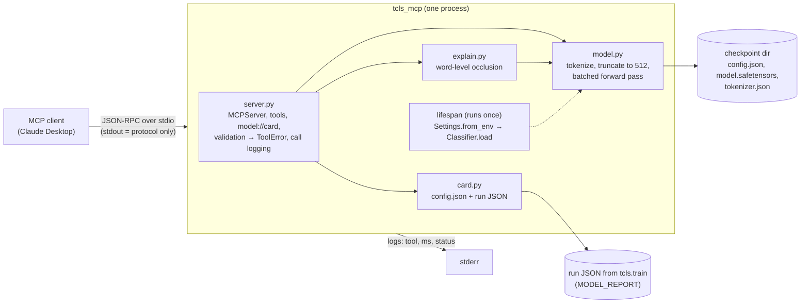

# Turkish Text Classification (BERTurk fine-tuning)

Fine-tuning `dbmdz/bert-base-turkish-cased` (BERTurk, MIT license) for two Turkish tasks and
comparing it against a TF-IDF + logistic regression baseline:

- **Task A:** news category classification (`savasy/ttc4900`, 7 classes)
- **Task B:** sentiment analysis (`winvoker/turkish-sentiment-analysis-dataset`, Positive / Negative / Notr)

Full project spec: [`berturk_project_spec.md`](berturk_project_spec.md).

## Status

| Stage | Status |
|---|---|
| 1. Skeleton and data | done |
| 2. Baseline | done ([results](reports/baseline_results.md)) |
| 3. BERTurk fine-tuning | code + CPU smoke test done; full runs NOT RUN (to be run on Colab/Kaggle) |
| 4. Evaluation and ablations | NOT RUN |
| 5. Demo (HF Spaces) | NOT RUN |
| 5b. MCP server (`tcls_mcp`) | code + tests + CPU benchmark done; served model is a smoke checkpoint until a full run exists |
| 6. Polish | NOT RUN |

Only baseline results exist so far. No BERTurk training run has been done yet: every full run below is
NOT RUN (to be run on Colab/Kaggle). BERTurk numbers will be added only from runs that were actually done.

## Data

Details: [`reports/data_summary.md`](reports/data_summary.md) (generated by `python -m tcls.data`).

| | TTC4900 | Turkish sentiment |
|---|---|---|
| Hub license | `unknown` (data card; source: Kemik group) | CC BY-SA 4.0 |
| Raw size | 4,900 (train only) | 440,679 train / 48,965 test |
| Test split | stratified 15%, seed 42 (no official test split) | official test split |
| Validation | stratified 15% of the train pool | stratified 10% of train |
| After cleaning (train/val/test) | 3,278 / 579 / 681 | 394,642 / 43,850 / 48,924 |

Cleaning: normalize whitespace, drop empty texts, drop texts that appear with conflicting
labels, and drop duplicates (key ignores case and whitespace). Any train text that also appears
in test is removed from train. The test split itself is never reduced by this step.

### Data observations (from the pipeline output)

- **TTC4900 has 362 duplicate or label-conflicting rows** (7.4% of the data), removed before
  splitting.
- **TTC4900 texts are long:** 87% exceed 128 BERTurk tokens and 56% exceed 256 (p95 ≈ 880).
  So `max_length` will truncate most documents, which makes the 128-vs-256 ablation especially
  relevant.
- **TTC4900 is fully lowercased** (0 uppercase characters) and preprocessed (collocations
  joined with `_`). A cased model sees out-of-distribution casing, which is a reason to try
  the uncased-vs-cased ablation.
- **Sentiment "Notr" is a source shortcut:** all 153,825 Notr training examples come from
  `wiki` (153,364) and `random` (461). None of the review or tweet sources contain any
  Notr examples. A model can therefore learn "Wikipedia style → neutral" instead of real
  neutrality. Neutral review text is not represented, so results on the Notr class need to be
  read with this in mind.
- Sentiment is imbalanced (Positive 53.5%, Notr 35.0%, Negative 11.5%), so **macro-F1** is the
  main metric.
- 352 sentiment train texts also appeared in the official test split and were removed from
  train.

## BERTurk fine-tuning (Aşama 3)

`python -m tcls.train --config <yaml> --seed <int> [--smoke]` fine-tunes with
`AutoModelForSequenceClassification` + `Trainer`. Every hyperparameter is in the YAML
(`training:` section; variants inherit with `base:`).

- **Model selection:** the Trainer evaluates on **validation** each epoch, early-stops on
  validation macro-F1 and reloads the best-on-validation checkpoint. Test is scored **once**,
  at the end of each run.
- **Output:** one JSON per run, `reports/berturk_<task>_<tag>_seed<N>.json`. It holds
  val/test accuracy, macro-F1, per-class P/R/F1, the confusion matrix, hyperparameters,
  training time and GPU name. Sentiment runs also include `Notr` P/R and per-source test
  metrics; the source is used for analysis only, never as a feature.
- **Checkpoints** are saved to `--output-dir` (or `$TCLS_OUTPUT_DIR`, or
  `training.output_dir`), which should be outside the repo, e.g. Drive or `/kaggle/working`.
- `--smoke` runs a stratified subset (200 train / 100 val / 100 test, max_length 64, 1 epoch)
  on CPU. It only checks that the pipeline works. Its JSON goes to `data/smoke_reports/`
  (gitignored), and its metrics are not results.

Planned runs, 3 seeds each (42, 43, 44). **All NOT RUN (to be run on Colab/Kaggle):**

| config | task | what changes |
|---|---|---|
| `configs/news_berturk.yaml` | news | max_length 128 (spec starting point) |
| `configs/news_berturk_len256.yaml` | news | max_length 256 |
| `configs/news_berturk_len512.yaml` | news | max_length 512 |
| `configs/news_berturk_len512_headtail.yaml` | news | 512 tokens: first 128 + last 382 |
| `configs/sentiment_berturk.yaml` | sentiment | max_length 128, stratified 50k train subset |
| `configs/sentiment_berturk_weighted.yaml` | sentiment | same + class-weighted loss |

The effective batch size is 32 everywhere: for longer inputs, per-device batch × gradient
accumulation is 16×2 or 8×4. Sentiment trains on a stratified, seeded 50k subset of the
394,642 training rows (`max_train_samples`) so that 3 seeds fit in free GPU time.
Validation and test are always complete.

### Colab

Open `notebooks/colab_train.ipynb`, choose *Runtime → T4 GPU*, set `REPO_URL`, then run all.
The notebook installs the package, mounts Drive, optionally reads `HF_TOKEN` from Colab
Secrets (never printed), rebuilds the splits and calls `python -m tcls.train` for every
config × seed. Run JSONs go straight to Drive, and `--skip-existing` lets a disconnected
session resume.

### Kaggle

1. New notebook → *Settings*: Accelerator **GPU T4**, Internet **on**. Optional: *Add-ons →
   Secrets* → `HF_TOKEN`.
2. Run:

```bash
export CUDA_VISIBLE_DEVICES=0   # "T4 x2" would otherwise double the effective batch via DataParallel
git clone --depth 1 <REPO_URL> repo && cd repo
pip install -q -e ".[train]"
python -m tcls.data --config configs/news_berturk.yaml configs/sentiment_berturk.yaml --no-tokens --summary /kaggle/working/data_summary.md
for cfg in configs/news_berturk.yaml configs/news_berturk_len256.yaml configs/news_berturk_len512.yaml configs/news_berturk_len512_headtail.yaml configs/sentiment_berturk.yaml configs/sentiment_berturk_weighted.yaml; do
  for seed in 42 43 44; do
    python -m tcls.train --config "$cfg" --seed "$seed" --output-dir /kaggle/working/checkpoints --report-dir /kaggle/working/reports --skip-existing
  done
done
cp /kaggle/working/reports/berturk_*.json reports/
python -m tcls.aggregate --configs configs/*.yaml
```

In a Kaggle notebook, put each line in a `!` cell, or wrap the block in `%%bash`. For
`HF_TOKEN`, use
`os.environ["HF_TOKEN"] = UserSecretsClient().get_secret("HF_TOKEN")` (from
`kaggle_secrets`) and never print it. Watch the weekly GPU quota on your Kaggle account page.
Download `/kaggle/working/reports/*.json` into the repo's `reports/` and commit them.

### Aggregation

`python -m tcls.aggregate --configs configs/*.yaml` writes `reports/berturk_summary.{md,json}`.
It reports mean ± sample std (ddof=1) over seeds next to the deterministic baselines, and
marks every planned config without runs as NOT RUN.

## MCP server (Aşama 5b)

`src/tcls_mcp/` serves the fine-tuned classifier as an [MCP](https://modelcontextprotocol.io)
server, so an LLM client such as Claude Desktop can call it as tools. It is built on the
official MCP Python SDK **v2** (`mcp>=2.3,<3`). In v2 the class formerly called `FastMCP`
is `mcp.server.MCPServer`; the decorator API is the same.

> **Model status:** no full BERTurk run exists yet (see above). Until one does, the server
> runs on a **smoke checkpoint** (1 epoch on 200 examples). Its predictions are not
> meaningful, and `model://card` says so (`"status": "smoke"`). Latency numbers are still
> valid, because latency depends on the architecture (BERT-base), not on the weights. After
> the Colab run, point `MODEL_PATH` at the best checkpoint and `MODEL_REPORT` at its run JSON.
> No code changes are needed.

### Tools and resource

| name | input | output |
|---|---|---|
| `classify_text` | `text: str` | `label`, `confidence`, `probabilities` (all labels), `truncated`, `input_tokens`, `used_tokens`, `warning` |
| `classify_batch` | `texts: list[str]` (1..`MAX_BATCH`, at most 64) | `count`, `label_counts`, `truncated_count`, `results[]` (same fields as above, input order) |
| `explain_prediction` | `text: str` | `label`, `confidence`, `method: "occlusion"`, `top_tokens[≤5]` (`token`, `start`, `end`, `contribution`), `words_evaluated`, `truncated` |
| `model://card` (resource) | – | JSON: name, version, status (`trained`/`smoke`/`unknown`), task, base model, labels, training-data summary and caveats, test metrics, warnings |

Every tool returns a Pydantic model, so the SDK publishes a JSON **outputSchema**. Every
parameter and output field has a description that the client LLM reads. The tools are
marked read-only and idempotent (`ToolAnnotations`).

The label order is not hard-coded. It is read from the checkpoint's `config.json`
(`id2label`; training sorts label names, so sentiment is `Negative, Notr, Positive`).

### Architecture



- **Loaded once:** the model and tokenizer load in the server's `lifespan` at startup and
  are shared by every call. A test asserts that the loader runs once for many calls.
- **Concurrency:** the SDK runs sync tools in worker threads. One lock serialises model
  access, so peak memory stays bounded. Throughput comes from batching inside a call
  (`classify_batch`).
- **Errors:** invalid input raises `ToolError`, so the client gets `isError: true` with a
  message it can act on, for example "texts has 65 items; the limit is 64 per call. Split
  the list…". Unexpected exceptions are logged with a traceback and returned as a generic
  tool error. The server keeps running in both cases.
- **Logging:** each call writes one line to stderr, for example
  `tool=classify_batch status=ok ms=116.5 n=8`. The status is `ok`, `invalid_input`,
  `error` or `internal_error`. Nothing is printed to stdout.

### Input validation

| input | behaviour |
|---|---|
| `""` | error: `text is empty…` |
| whitespace only | error: `text contains only whitespace…` |
| longer than 512 tokens | classified on the first 511 tokens plus `[SEP]`; `truncated: true`, `input_tokens`, and a `warning` in the output |
| more than 100,000 characters | error (guards against pathological inputs before tokenization) |
| `texts: []` | error: `texts is an empty list…` |
| more than `MAX_BATCH` texts | error naming the limit and asking for chunks |
| bad item in a batch | error naming its index, for example `texts[2] contains only whitespace` |
| wrong type or missing argument | rejected by the SDK against the input schema |

### explain_prediction: why occlusion, and its limits

**Method:** words come from BERTurk's pre-tokenizer, so punctuation is a separate word.
For each word, all of its WordPiece sub-tokens are replaced with `[MASK]`, and the
explanation records the drop in the predicted label's probability. The variants run in
batches of `EXPLAIN_BATCH_SIZE` (default 32). The top 5 words are returned, highest first.
A positive contribution supports the prediction; a negative one argues against it.

**Why not attention?** Attention weights show where the model looks, not what changes its
output. They are spread over 12 layers × 12 heads, and they often peak on `[CLS]`, `[SEP]`
and punctuation. Occlusion is model-agnostic, needs no gradients, and its number has a
direct meaning: "without this word, P(label) drops by x". A test checks this definition.

**Limits:**
- Each word is removed on its own, so interactions are missed. In *"hiç iyi değil"*, masking
  only *değil* or only *iyi* may each look small.
- `[MASK]` in many positions is out of distribution for a fine-tuned classifier, so the
  scores are approximate.
- The cost is one forward pass per word. Long texts are slow, and only words inside the
  first 512 tokens are evaluated (`truncated: true`).
- It explains the model, not the truth. On the smoke checkpoint the explanations are noise.

### Configuration (environment variables)

| variable | default | meaning |
|---|---|---|
| `MODEL_PATH` | required | checkpoint dir (`config.json`, `model.safetensors`, `tokenizer.json`) |
| `MAX_BATCH` | `64` | `classify_batch` limit, 1..64; also the inference batch size |
| `DEVICE` | `auto` | `auto` (CUDA if available), `cpu`, `cuda`, `cuda:N` |
| `MODEL_REPORT` | unset | run JSON from `tcls.train`; fills task, data and metrics in `model://card` |
| `EXPLAIN_BATCH_SIZE` | `32` | forward-pass batch size for occlusion |
| `LOG_LEVEL` | `INFO` | stderr log level |

Bad configuration, for example a missing `MODEL_PATH` or `DEVICE=cuda` without CUDA, stops
the server at startup with a clear message. It does not fail later during a call.

### Install and run

```bash
uv sync --extra serve      # mcp + torch (Windows/macOS: CPU wheel from PyPI)
MODEL_PATH=data/smoke_checkpoints/berturk_sentiment_len128_n50k_seed42_smoke/checkpoint-13 \
MODEL_REPORT=data/smoke_reports/berturk_sentiment_len128_n50k_seed42_smoke.json \
uv run python -m tcls_mcp  # stdio server; silence on start is normal
```

Docker (CPU image, the checkpoint is mounted read-only):

```bash
docker build -t tcls-mcp .
docker run -i --rm -v /abs/path/to/checkpoint-NNN:/models:ro tcls-mcp
# or
MODEL_DIR=/abs/path/to/checkpoint-NNN docker compose run --rm -T berturk-mcp
```

### Connect to Claude Desktop

Edit `%APPDATA%\Claude\claude_desktop_config.json` on Windows, or
`~/Library/Application Support/Claude/claude_desktop_config.json` on macOS, then quit
Claude Desktop fully and reopen it. Use absolute paths. Point `command` at the project venv's
Python directly: this starts faster than `uv run` and avoids a sync on every launch.

```json
{
  "mcpServers": {
    "berturk": {
      "command": "C:\\Users\\<you>\\Documents\\cv1\\.venv\\Scripts\\python.exe",
      "args": ["-m", "tcls_mcp"],
      "env": {
        "MODEL_PATH": "C:\\Users\\<you>\\Documents\\cv1\\data\\smoke_checkpoints\\berturk_sentiment_len128_n50k_seed42_smoke\\checkpoint-13",
        "MODEL_REPORT": "C:\\Users\\<you>\\Documents\\cv1\\data\\smoke_reports\\berturk_sentiment_len128_n50k_seed42_smoke.json",
        "DEVICE": "cpu",
        "MAX_BATCH": "64"
      }
    }
  }
}
```

Docker variant:
`"command": "docker", "args": ["run", "-i", "--rm", "-v", "C:\\path\\to\\checkpoint-NNN:/models:ro", "tcls-mcp"]`.
The server log is in Claude Desktop's MCP log file (`mcp-server-berturk.log` in Claude's
`logs` folder).

### Example scenario

With the server connected, paste the 20 reviews from
[`examples/reviews_20.txt`](examples/reviews_20.txt) and ask:

> Şu 20 müşteri yorumunu sınıflandır, dağılımı ve en olumsuz 3 yorumu özetle.

What should happen:
1. Claude reads `model://card` if it was attached, or it can be asked to. A smoke model
   shows a warning that a careful answer should repeat.
2. One `classify_batch` call with all 20 texts, not 20 `classify_text` calls.
   `label_counts` gives the distribution.
3. Claude ranks the texts by `probabilities.Negative`, takes the top 3 and summarises them.
   Optionally, it calls `explain_prediction` on them to show which words drove each one.

### Latency benchmark

`MODEL_PATH=... uv run python benchmarks/latency.py --device cpu --repeats 20` writes
[`benchmarks/results.md`](benchmarks/results.md). It measures end-to-end MCP tool calls
through an in-memory client, so serialization and schema validation are included and the
stdio transport is not. Inputs are the 20 example reviews (7-12 words). The results below
are from a laptop CPU (Intel Core 12th gen, 14 threads, torch 2.15.0+cpu, Windows),
BERT-base, `LOG_LEVEL=WARNING`:

#### classify_text

| calls | mean (ms) | p95 (ms) |
|---:|---:|---:|
| 100 | 26.8 | 30.3 |

#### classify_batch

| batch size | mean per call (ms) | p95 per call (ms) | mean per text (ms) |
|---:|---:|---:|---:|
| 1 | 29.1 | 32.0 | 29.1 |
| 8 | 116.5 | 121.8 | 14.6 |
| 32 | 361.1 | 392.0 | 11.3 |
| 64 | 732.5 | 949.5 | 11.4 |

#### explain_prediction

| calls | mean (ms) | p95 (ms) |
|---:|---:|---:|
| 20 | 463.4 | 690.0 |

Laptop CPU timings are noisy (turbo boost and thermals). In two runs, `explain_prediction`
varied between ~165 and ~465 ms. Batching cuts the per-text cost by about 2.5× from batch 1
to batch 32/64. GPU timings were not measured: the local torch is a CPU build.

### Known limitations

- **No trained model yet:** only the smoke checkpoint has been served (see the note above).
  Test metrics in `model://card` come only from a run JSON. Nothing is invented.
- **Length mismatch:** the sentiment model is trained with `max_length=128`, while the
  server accepts up to 512 tokens. Longer reviews are inputs the model never saw in
  training. The card warns about this.
- **Head truncation only:** the server keeps the first 512 tokens. The news `len512_headtail`
  model was trained on head+tail, so its long-text predictions would differ (the card warns).
- **"Notr" means encyclopedic style:** in the training data every neutral example comes
  from Wikipedia or random sources, none from reviews. So neutral customer reviews (for
  example "Paket 12 adet olarak geldi") are out of distribution and may get an arbitrary
  label (see the data notes above). This has not been measured yet.
- **Uncalibrated probabilities:** `confidence` is a softmax output, not a calibrated
  probability.
- **One model per process, calls serialised:** to serve both tasks, run two server entries
  with different `MODEL_PATH`s.
- **stdio only:** there is no HTTP transport or authentication. The server is meant for a
  local client.
- **Docker image not verified here:** the Dockerfile has not been built in this environment
  yet.

### Tests

`tests/serve/` builds a tiny random BERT (2 layers, hidden 32) with a Turkish WordPiece
vocab in a temp dir. The tests therefore run offline in seconds and still exercise the real
`Classifier.load`. They cover tool listing, schemas and descriptions; output schema
validation; every invalid input; truncation; batch results equal to single results
(same label, probabilities within 1e-5); load-once; the model card; the occlusion
definition; and a real stdio subprocess round trip that checks the stderr logs. If
`torch`/`mcp` are not installed, the directory is skipped. CI installs the locked
`serve` extra with a CPU torch wheel.

## Setup

```bash
uv sync                     # core + dev tools (no torch)
uv sync --all-extras        # + torch/accelerate/evaluate (train) and gradio (demo)
```

Reproduce the data splits and summary (downloads the datasets to `data/`, which is gitignored):

```bash
uv run python -m tcls.data --config configs/news_berturk.yaml configs/sentiment_berturk.yaml
```

Baselines (TF-IDF word 1-2 grams; C chosen on validation; test evaluated once):

```bash
uv run python -m tcls.baseline --config configs/news_berturk.yaml configs/sentiment_berturk.yaml --notes reports/baseline_notes.md
```

Checks (same as CI):

```bash
uv run ruff check . && uv run ruff format --check . && uv run mypy && uv run pytest
```

Network tests against the real Hub datasets: `uv run pytest -m slow`.

## Secrets

The only key is an optional `HF_TOKEN` (free, write scope) for pushing to the Hub. It is read
only from environment variables or Colab/Kaggle Secrets, and is never committed. `.env` is
gitignored.
